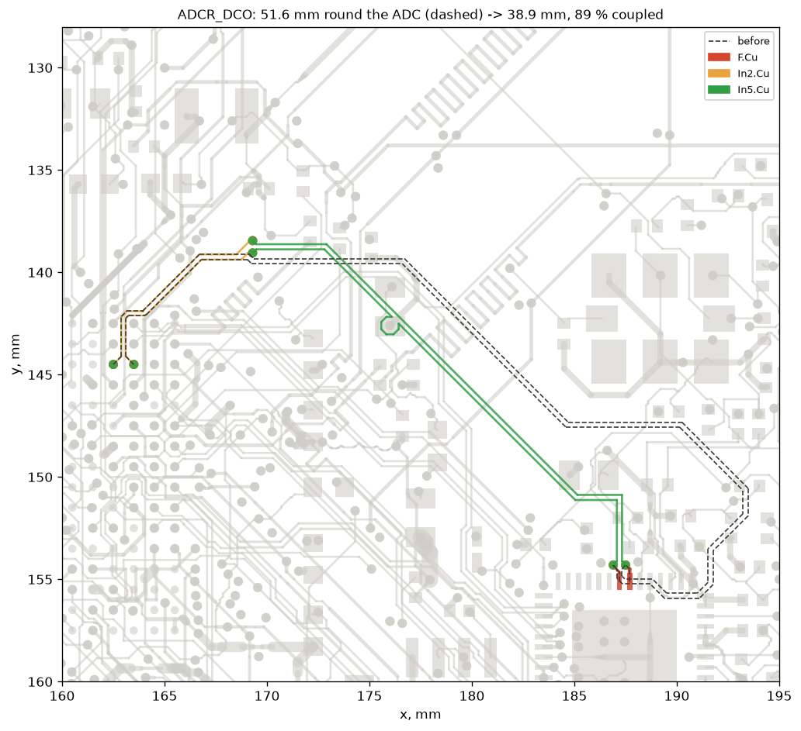
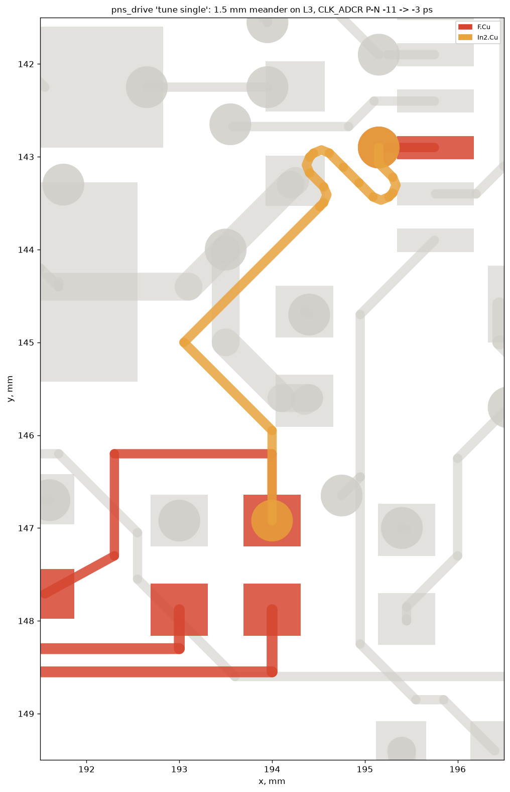
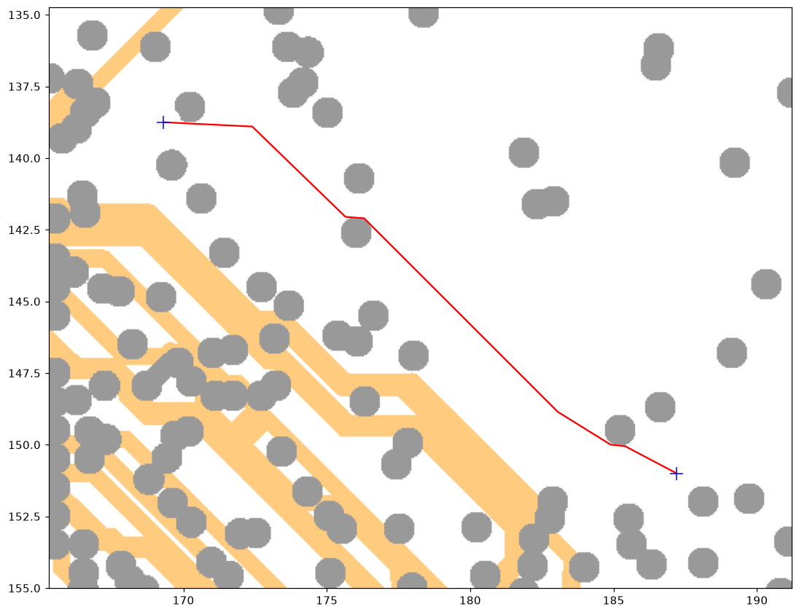
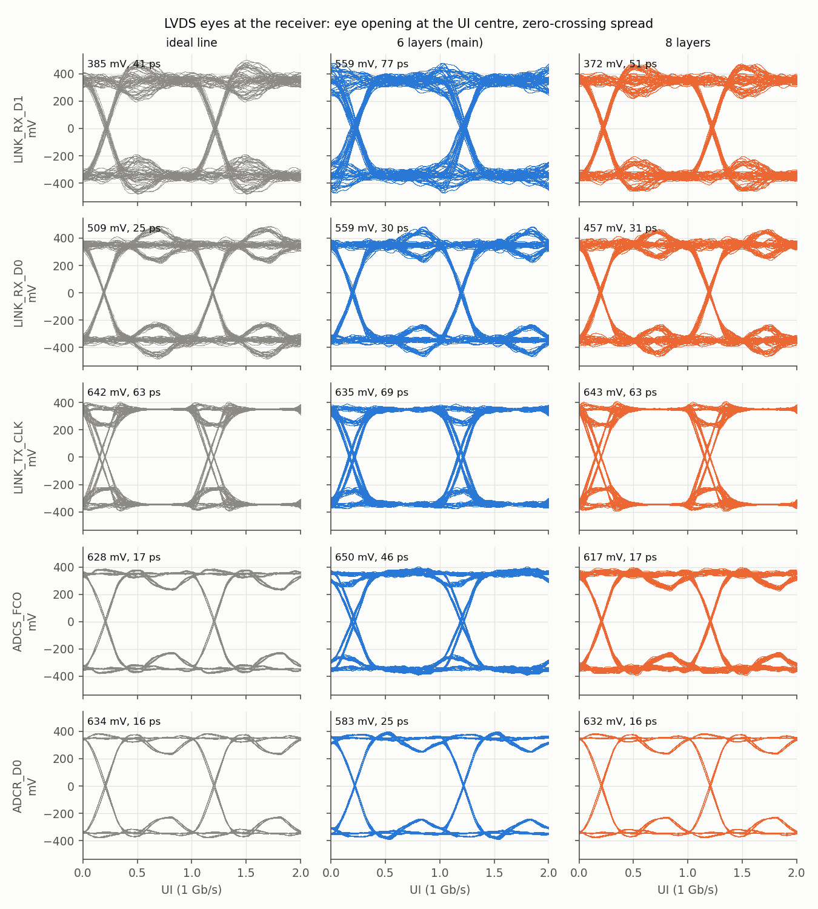
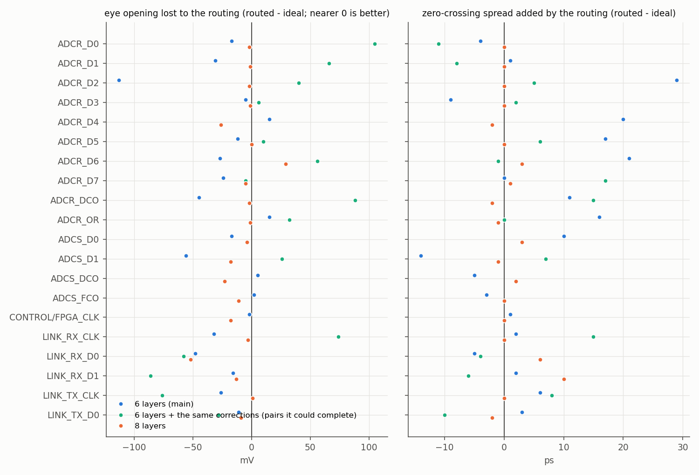
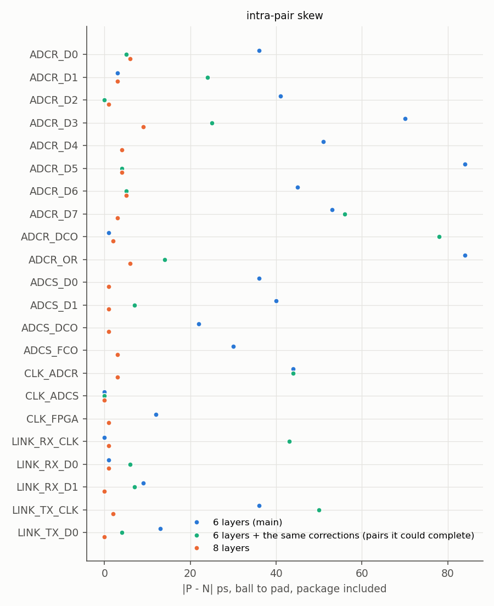

# kicad-pcb-routing-tools

Scripts that routed, length-matched and checked a dense 8-layer KiCad 10 board, and simulated the
result. The board is [kv260-ias2rf](https://github.com/PabloSoage/kv260-ias2rf), an RF front-end
carrier for the AMD Kria KV260 with 19 LVDS pairs around a 256-ball FPGA. It has 0 DRC errors.

The tools are in three groups:

- **Routing.** A negotiated-congestion A* router for differential pairs, small A* routers for the
  last connections, and **`pns_drive`**: KiCad's own interactive router (PNS) run headless from a
  text script, so it can shove, walk around, route coupled pairs and tune lengths without the GUI.
- **Post-processing.** Meanders for skew, widening legs to their 50 Ω width, adding return vias,
  removing stubs, dangling copper and duplicate vias.
- **Measurement and simulation.** Intra-pair and data-to-clock skew, return paths, crosstalk, PDN
  impedance and DC drop. A 2-D field solver, LVDS eyes in ngspice and an SMA launch in openEMS.

Every Python tool reads the `.kicad_pcb` as **text** and edits it as text. None of them imports
`pcbnew`. That keeps them out of KiCad's GUI process, which on Windows pops modal dialogs. KiCad
itself is used only through `kicad-cli`, for the DRC, zone refills and exports.



*A coupled pair re-routed with `pns_drive`: 51.6 mm round the ADC (dashed) became 38.9 mm, 89 %
coupled. The path came from `waypoints.py`, and KiCad's router shoved the pairs in the way.*

## Contents

```
toolpaths.py              finds kicad-cli (env KICAD_CLI, PATH, KiCad 10 install folders)
layout/
  geo.py                  board copper as shapely geometry per layer/net; netclass clearances
  pairlib.py              coupled pair as a centre line on a grid, split into two legs
  plotnets.py             picture of a box of the board, chosen nets highlighted, before/after
  lvds_skew.py            per-pair delay, P-N skew, stubs, coupling; data-to-clock per bus
  fastroute.py            raster A* for one connection (waypoints, cost boxes, layer costs)
  handroute.py            the same on exact geometry (slower, no raster)
  mini_route.py           multi-layer A* that joins a net's copper islands
  meander.py              rectangular bumps on one segment, by a length to add
  drop_dangling.py        deletes what kicad-cli's DRC calls dangling, repeatedly
  merge_vias.py           merges vias of one net closer than the hole-to-hole rule
  nudge_vias.py           moves vias out of clearance errors reported by the DRC
  rip_violations.py       rips the copper the DRC reports in violation
  netdump.py              segments and vias of the nets matching a regex, one per line
  planechk.py             signal copper on the ground planes
  route_finish.sh         KiCadRoutingTools on the incomplete nets only, the rest protected
  setup_krt.sh            checks out KiCadRoutingTools in a venv
  levers/
    pairprep.py           ball vias (via in pad) and terminations on the bottom for every pair
    pairroute.py          routes pairs one by one, coupled, ball vias to the far pads
    pairnego.py           PathFinder negotiated congestion over all the pairs at once
    pairnego_mp.py        the same, each round's re-routes in parallel (shared memory)
    ripbad.py             DRC, then rips every pair with a copper violation (keeps ball vias)
    widen.py              legs to the layer's 50-ohm width where clearances allow, else necks
    skewfix.sh            meanders every pair's early leg to |P-N| <= LIMIT ps
    automeander.sh        meander.py on a net's longest segments until N mm are added
    stubrip.py            removes the branches off a leg's pin-to-pin path
    retvias.py            GND via next to every reference-changing via of a pair
    rfstitch.py           GND vias beside RF vias and fences along RF lines
    audit.py              reference-plane voids, return vias, parallel runs, acute angles
    xtalk.py              legs of different pairs side by side, by gap
    pdn2.py               PDN impedance at a BGA's balls from the copper, caps and planes
    irdrop.py             DC drop from a rail's source to the BGA's balls
    segadd.py segdel.py ripbox.py freespot.py viaspot.py edit.py fp.py   small editors and finders
  pnsdrive/
    pns_drive.cpp         KiCad's PNS router driven by a text script (GPL, builds in KiCad's tree)
    CMakeLists.fragment.txt, kicad-build.def, pns.sh, examples/*.pns
    waypoints.py          global A* path on one layer for pns_drive to follow
    closegap.py           joins dangling ends to the nearest via/pad of their net
    straighten.py         Douglas-Peucker on a net's chain, kept only if it stays clear
    swap_polarity.py      swaps a pair's legs at one chip (FPGA polarity inversion)
sim/
  field_solver.py         2-D finite-difference solver: microstrip, stripline, coupled pairs
  field_solver8.py        the 8-layer stack-up's widths (JLC08161H-2116C)
  lvds_eye.py             eye of a pair as routed (field-solved sections) vs ideal, in ngspice
  sma_launch.py           edge-SMA launch in openEMS (S11/S21)
```

Many defaults are the kv260-ias2rf board's: its net names (`ADCR_*`, `LINK_RX_*`), its FPGA
(`U1101`), its netclasses (`LVDS100`, `RF50`) and its layer names. They are command-line options or
constants at the top of each script. Change them for another board.

## Requirements

- KiCad 10 (`kicad-cli`). Set `KICAD_CLI` if it is not on `PATH` or in KiCad's default install folder.
- Python 3.11+ with `pip install -r requirements.txt` (shapely, numpy, scipy, matplotlib).
- For `route_finish.sh`: [KiCadRoutingTools](https://github.com/drandyhaas/KiCadRoutingTools)
  (MIT, not included), and `KRT` pointing at its checkout (`layout/setup_krt.sh <dir>` makes one).
- For `lvds_eye.py`: ngspice on `PATH`. On Windows you can instead set `LVDS_EYE_WSL=1` to run it
  inside WSL, with `LVDS_EYE_NGSPICE` as the command there.
- For `sma_launch.py`: openEMS 0.37 with its Python bindings.
- For `pns_drive`: a KiCad 10.0.8 source tree, built on Linux (see below).

The `.kicad_pro` (and `.kicad_dru`, if any) must sit next to the `.kicad_pcb`: `geo.py` reads the
netclasses and clearances from it.

## How the board was routed

```mermaid
flowchart LR
    A[placed board] --> B[pairprep.py<br/>ball vias + terminations]
    B --> C[pairnego_mp.py<br/>negotiated congestion]
    C --> D[ripbad.py<br/>DRC, rip bad pairs]
    D -->|ripped pairs| C
    D --> E[route_finish.sh<br/>KiCadRoutingTools, rest protected]
    E --> F[drop_dangling / merge_vias]
    F --> G[widen.py, skewfix.sh<br/>retvias.py]
    G --> H[pns_drive<br/>shove, coupled re-routes, tuning]
    H --> I[DRC + lvds_skew, audit,<br/>xtalk, pdn2, lvds_eye]
    I -->|a pair to fix| H
```



1. **`pairprep.py`** puts a via in pad at every LVDS ball of the FPGA and moves the 100 Ω
   terminations to the bottom face, straddling their two ball vias.
2. **`pairnego_mp.py`** routes all the pairs at once, coupled, as centre lines on a 0.05 mm grid
   (`pairlib.py`). Each round, every pair still in conflict is re-routed with the others'
   occupancy as a cost, not an obstacle. Where two pairs still overlap, that cost grows: a present
   factor every round and a history term for good (PathFinder, McMurchie and Ebeling 1995). It
   stops when no pair overlaps another, or when no round improves.
3. **`ripbad.py`** runs the DRC and rips the pairs that fail it. They go back to step 2 with the
   rest fixed.
4. **`route_finish.sh`** hands the incomplete nets to KiCadRoutingTools. Every complete net goes in
   as protected, so nothing that works is ripped. The legs it routes are single-ended.
5. **`widen.py`** brings the single-ended legs to their layer's 50 Ω width, necked only where
   something is in the way. **`skewfix.sh`** meanders each early leg to |P−N| ≤ 5 ps.
   **`retvias.py`** adds a GND via within 1 mm of every via that changes reference plane.
6. **`pns_drive`** does what the grid routers cannot. It moves a pair through a crowded corridor by
   shoving the tracks there. It re-routes a coupled pair along a path from `waypoints.py`, and it
   tunes a length with KiCad's own meander placer.

After each step comes the DRC (`kicad-cli pcb drc --refill-zones --schematic-parity`) and
`lvds_skew.py`.

## `pns_drive`: KiCad's router without the GUI

KiCad's interactive router (`pcbnew/router`, "PNS") has the best shove and walkaround of any open
router, but it only runs inside the editor. `pns_drive` links it into a small program that loads a
board, its project and its custom DRC rules. It then runs a script of mouse-like commands and saves
the result:

```
load board.kicad_pcb            # .kicad_pro and .kicad_dru beside it
mode dp                         # single | dp (differential pair)
policy shove                    # shove | walk | mark
size 0.10 0.15                  # track width and pair gap; "size 0 0" = the rules
start 167.7 139.9 In5.Cu ADCR_DCO_P
follow 168.4 140.2 171.1 140.85 175.25 144.95 182.85 150.95 187.2 152.1
finish 186.9 154.3              # snaps to the pad/via there and fixes the route
length ADCR_DCO_P
save out.kicad_pcb
```

The other commands are `move`, `fix`, `layer`, `via`, `commit`, `abort`, `drag`,
`amp MIN MAX SPACING`, `tune single|dp|skew X1 Y1 X2 Y2 LAYER TARGET`, `fixall`, `shovevias` and
`violate`. They are listed at the top of `pns_drive.cpp`.



*`tune single` on one segment of a clock leg: KiCad's meander placer added 1.5 mm and brought the
pair's P−N from −11 to −3 ps.*

**Build.** The build is done once, in a container, so nothing goes into the host system:

```sh
apptainer build --fakeroot --ignore-subuid kicad-build.sif layout/pnsdrive/kicad-build.def
apptainer build --sandbox kicad-build.sbx kicad-build.sif        # optional, faster to start
git clone --branch 10.0.8 --depth 1 https://gitlab.com/kicad/code/kicad.git src
cp layout/pnsdrive/pns_drive.cpp src/qa/tools/pns/
cat layout/pnsdrive/CMakeLists.fragment.txt >> src/qa/tools/pns/CMakeLists.txt
apptainer exec kicad-build.sbx cmake -S src -B build -G Ninja -DCMAKE_BUILD_TYPE=Release \
    -DKICAD_BUILD_QA_TESTS=ON -DKICAD_BUILD_PNS_DEBUG_TOOL=ON -DKICAD_SCRIPTING_WXPYTHON=OFF
apptainer exec kicad-build.sbx ninja -C build pns_drive
```

**Run.** Scripts run with `PNS_DRIVE=build/qa/tools/pns/pns_drive PNS_SBX=kicad-build.sbx
layout/pnsdrive/pns.sh my.pns`. `pns.sh` turns address randomisation off, because the router's
choices depend on pointer order. `SEED=n` moves the heap to try another order reproducibly.

**What it took** (for anyone driving PNS outside the editor):

- A `PGM_BASE` must exist before anything loads: `MOCK_PGM_BASE`, `Pgm().InitPgm(true, true, true)`,
  and `PCBNEW_SETTINGS` registered. Without it the load segfaults.
- Call `BOARD::SynchronizeTuningProfileProperties()` after loading. Without it, length tuning
  crashes in the via propagation delay lookup.
- The router needs a `DEBUG_DECORATOR`, even a no-op one.
- `MEANDER_SETTINGS::m_netClass` must be set before tuning.
- In differential-pair mode, `FixRoute` returns false when it fixed part of the route but did not
  reach the end. Progress has to be measured as a change in the net's routed length.
- A layer change in a pair is: toggle via, fix, then `SwitchLayer`.
- Pass the end item to the last `Move()` before `FixRoute`, or the route does not snap to the pad.
- Shoving vias can leave a track end off the via's centre (the via moves, the end stays). With
  `ShoveVias(false)` the tracks are shoved and the vias stay.

## `waypoints.py`: a global path for the local router

PNS is a local router: from a start point, it pushes toward wherever the cursor is. Over 20 mm of
congested board it needs a corridor. `waypoints.py` finds one with an 8-direction grid A* on one
layer. Pads, vias and tracks it must not touch are hard obstacles, grown by the clearance plus half
the pair's width. Tracks that the router can shove (`--soft`, by default the LVDS nets) are
passable at a cost. It prints `move X Y` lines for a `follow`, and with `--png` it draws the map:



*Grey: hard obstacles on In5. Orange: tracks KiCad can shove aside. Red: the path handed to
`pns_drive`.*

When there is no path, `--png` draws the blocked map anyway, so you can see what is in the way.

## Measuring

```sh
python layout/lvds_skew.py board.kicad_pcb            # P, N delay, P-N, stubs, coupled %, layers
python layout/levers/audit.py board.kicad_pcb         # voids under fast tracks, return vias, ...
python layout/levers/xtalk.py board.kicad_pcb         # other pairs' legs within 0.25 / 0.55 mm
python layout/levers/pdn2.py board.kicad_pcb U1101 +1V0:0.12 +2V5:2.0 --fmax 1e8 --out pdn/
python layout/levers/irdrop.py board.kicad_pcb U1101 +2V5:0.601
python sim/lvds_eye.py board.kicad_pcb --pair /LINK_RX_D0 --save eyes/
python sim/field_solver8.py                           # widths for 50 ohm / 100 ohm on the stack
```

`lvds_skew.py` follows each leg from pin to pin through series parts (AC capacitors, resistors).
Its delay uses a per-layer ps/mm, plus the vias and the FPGA's package delays. Those come from
`xc7a50t_ftg256_pkg_delays.csv`, Vivado's per-pin figures; replace the file for another part, or
pass `--no-pkg`. Branches off the path are reported as stubs, in ps.

`lvds_eye.py` cuts each leg into sections by layer and width. It solves each section's Z0 and delay
with the field solver, builds the two legs as lossless lines in ngspice with the receiver's
termination and input capacitance, runs PRBS7 at 1 Gb/s, and folds the eye. It does the same for
an ideal 100 Ω pair of the same length, so the difference is what the routing costs:







## License

GPL-3.0-or-later (see `LICENSE`). `pns_drive.cpp` links KiCad, which is GPL-3.0-or-later.
KiCadRoutingTools is a separate MIT project and is not included.
